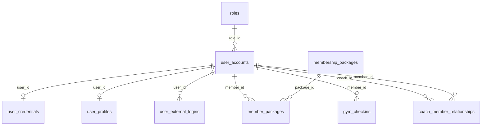
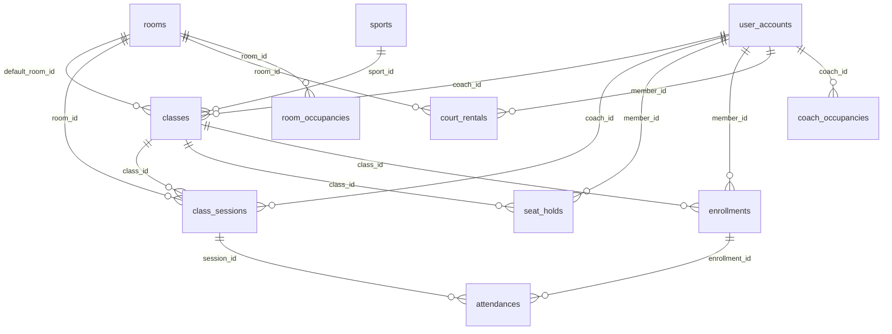
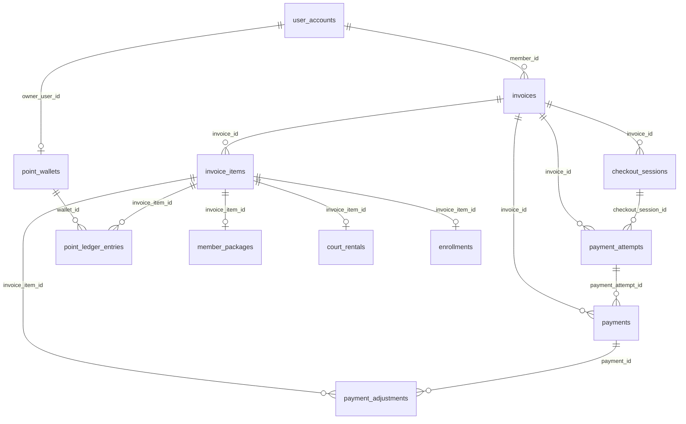
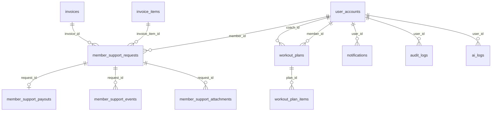

# ERD — quan hệ dữ liệu SportHub

Nguồn: EF Core model snapshot và migrations ở commit [`8bbe165`](https://github.com/SWP391-SportHub-Group4/sports-center-management-system/tree/8bbe16574197a8863150dab3a1b37e6d2fbf5bc5) của `main` repo ứng dụng. Các sơ đồ chia theo luồng để đọc được trên GitHub; chúng chỉ thể hiện **FK thật** của những bảng nghiệp vụ chính. Toàn bộ 69 bảng và 138 FK nằm trong [từ điển schema](schema/README.md). Ký hiệu `||` là một, `o{` là nhiều, `o|` là không hoặc một; cột nullable và hành vi xóa xem từ điển.

## Danh tính và Membership

`user_accounts` là bảng định danh chung cho năm role; credential, profile và đăng nhập ngoài tách riêng. `member_packages` là quyền Gym/vé đã cấp, còn `membership_packages` là catalog. Sự hiện diện của FK không tự chứng minh role của user: các dịch vụ nghiệp vụ vẫn kiểm role/trạng thái.

## Danh mục, lớp, chỗ giữ và sân

`room_occupancies` và `coach_occupancies` dùng cặp `source_type`/`source_id` để chỉ nguồn chiếm lịch; cặp này không phải FK đa hình đến lớp/rental/block. Việc chống trùng thực tế do exclusion constraints trên khoảng thời gian và cùng các transaction ghi occupancy thực hiện. `SeatHold` là chỗ tạm; `Enrollment` là ghi danh cả khóa sau thanh toán.

## Hóa đơn, thanh toán và ví điểm

`invoice_items` giữ snapshot món/giá; `checkout_sessions` và `payment_attempts` giữ vòng đời thử thanh toán. `payments` chỉ ghi khoản đã xác minh. Các cạnh từ invoice item đến quyền lợi có thể nullable/được ràng buộc bằng unique có điều kiện; xem [schema Payment](schema/payment.md) và [schema Scheduling](schema/scheduling.md). Không suy rằng một invoice item đồng thời cấp cả ba loại quyền lợi.

## Hỗ trợ, tập luyện và sự kiện

Một số bản ghi như log, audit hoặc media có tham chiếu logic thay vì FK để giữ lịch sử khi tài nguyên nguồn đổi. Từ điển schema phân biệt rõ FK thật với cột ID thông thường.
