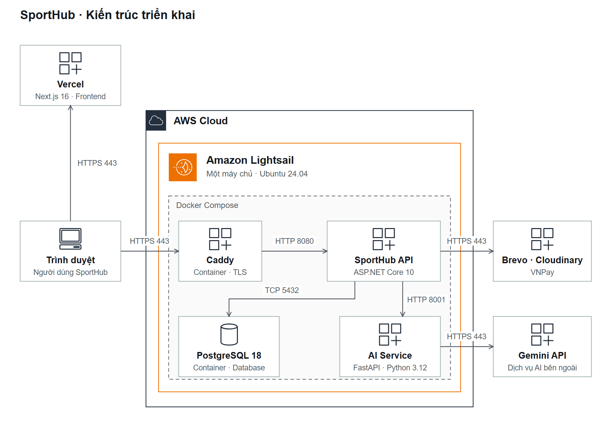

# SportHub Deployment Design

**Phiên bản 1.0 · 17/11/2026**

Tài liệu mô tả nơi các thành phần SportHub chạy, cách chúng kết nối và cách phát hành, kiểm tra, khôi phục một bản triển khai. Thiết kế AWS được đối chiếu với bản `origin/main` lưu trong checkout tại commit `7fd6950b`. Trạng thái đang chạy trên AWS, cấu hình Vercel và chế độ truy cập PostgreSQL cần được xác nhận trên từng môi trường.

## 1. Kiến trúc triển khai



Sơ đồ sử dụng AWS Architecture Icons phát hành ngày 31/07/2026. Amazon Lightsail dùng biểu tượng dịch vụ chính thức, các phần mềm và cơ sở dữ liệu dùng biểu tượng tài nguyên tổng quát. Khung nét đứt thể hiện Docker Compose, hướng mũi tên thể hiện bên khởi tạo kết nối. Nguồn biểu tượng tại [AWS Architecture Icons](https://aws.amazon.com/architecture/icons/).

Thành viên nhóm phát triển xem [Member Guide — Kết nối hệ thống](MemberGuide.md) để truy cập website, chạy local và kết nối DB AWS.

| Thành phần | Nơi chạy | Vai trò khi triển khai |
| --- | --- | --- |
| Frontend | Vercel, thư mục `frontend/`, Next.js 16 và React 19 | Phục vụ giao diện. Mã chạy trên trình duyệt gọi trực tiếp API AWS qua HTTPS. |
| Caddy | Container `caddy` trên Lightsail | Nhận truy cập cổng `80/443`, xử lý HTTPS và chuyển yêu cầu đến `backend:8080`. DNS của miền API trỏ về máy chủ Lightsail. |
| Backend | Container `backend` trên Lightsail | API ASP.NET Core 10 dạng modular monolith. Các tác vụ nền về hết hạn, thông báo và đối soát chạy cùng tiến trình API. |
| Cơ sở dữ liệu | Container `postgres` trên Lightsail | PostgreSQL 18 (`postgres:18-bookworm`). Backend kết nối qua `postgres:5432`. |
| AI Service | Container `ai-service` trên Lightsail | FastAPI trên Python 3.12 và Uvicorn. Backend gọi `http://ai-service:8001`, dịch vụ này gọi Gemini. |
| Khởi tạo lưu trữ | Container `storage-init` trên Lightsail | Chuẩn bị thư mục và quyền ghi cho volume chứa khóa Data Protection và báo cáo trước khi backend khởi động. |

Runbook ghi nhận máy Lightsail có 2 vCPU, 2 GB RAM và 60 GB đĩa. Backend và AI image được build trên GitHub Actions, giúp giảm tải cho máy chủ khi phát hành. Một máy chủ vận hành cả proxy, API, AI và DB. Khi máy chủ gặp sự cố, các chức năng phụ thuộc API có thể gián đoạn cùng lúc. Mỗi lần cập nhật AWS có khoảng gián đoạn khi sao lưu, chạy migration và khởi động lại.

## 2. Môi trường chạy

| Môi trường | Thành phần và cấu hình | Dữ liệu |
| --- | --- | --- |
| Phát triển local | Docker Compose cho PostgreSQL 16 và AI. API có thể chạy bằng .NET SDK 10 ở `Development` và frontend bằng Node.js 24 với `npm run dev`. Địa chỉ mặc định `localhost:3000` (web), `localhost:5000` (API), `localhost:5435` (DB), `127.0.0.1:8001` (AI). | DB local riêng. Chạy toàn bộ stack bằng Compose cũng được hỗ trợ. |
| Kiểm thử CI | GitHub Actions chạy build/test backend, lint/typecheck/build frontend, Playwright và kiểm tra script triển khai. E2E dùng PostgreSQL 16 riêng và API ở `Development`. | Database `sporthub_e2e`, với dữ liệu test được tạo trên runner. |
| Production | Vercel phục vụ frontend. Ubuntu 24.04 trên Lightsail chạy Compose project `sporthub-aws` với API ở `Production`, AI và PostgreSQL 18. | Dữ liệu vận hành và tệp runtime lưu trên Docker volumes của máy AWS. |

### Chạy local

1. Tạo `.env` ở gốc repo từ `.env.example` nếu tệp chưa tồn tại. Điền cấu hình PostgreSQL và khóa JWT local. Với API chạy trực tiếp, `ConnectionStrings__Default` trỏ về `localhost:5435`. Để kiểm tra các luồng AI cần Gemini, cấu hình `ai-service/.env` với `GEMINI_API_KEY`.
2. Khởi động `docker compose up -d postgres ai-service`. Nếu cần đổi cổng AI thì đồng bộ cấu hình API với cổng mới.
3. Từ gốc repo, chạy API trong PowerShell:

   ```powershell
   dotnet run --project backend/SportHub.API/SportHub.API.csproj -c Release -- --environment=Development --urls=http://localhost:5000 --DataProtection:KeysPath="$PWD/.tmp/local-api-keys"
   ```

4. Trong thư mục `frontend`, chạy `npm ci` rồi `npm run dev`. Nếu đổi cổng API, cập nhật `NEXT_PUBLIC_API_BASE_URL` trong `frontend/.env.local` rồi khởi động lại frontend.
5. Mở `http://localhost:3000` và kiểm tra `http://localhost:5000/api/health`. Có thể chạy toàn bộ hệ thống bằng `docker compose up -d --build` sau khi chuẩn bị các tệp cấu hình local.

### Kết nối cơ sở dữ liệu từ xa

Ở cấu hình AWS mặc định (`POSTGRES_ACCESS=private` trên `origin/main`), chỉ Caddy publish cổng ứng dụng ra host. SSH quản trị dùng cổng `22` theo phạm vi nguồn được cấp quyền. Các cổng nội bộ `5432`, `8001` và `8080` không được publish. Khi cần dùng DB từ ngoài host, repo mô tả hai phương án:

| Phương án | Đường kết nối | Điều kiện |
| --- | --- | --- |
| SSH tunnel | Máy dev `127.0.0.1:15432` → SSH → PostgreSQL `5432` trong mạng Docker | Áp dụng với profile `private`. Mỗi thành viên sử dụng tài khoản DB riêng. |
| Kết nối trực tiếp có TLS | Máy dev → AWS TCP `15432` → PostgreSQL `5432` | Operator phải bật profile `public`, chuẩn bị chứng chỉ và thay đổi firewall. PostgreSQL dùng TLS và SCRAM. Client dùng `SSL Mode=VerifyFull` với CA được cấp. Việc merge mã không tự bật cổng này. |

Khi trỏ API local vào DB website, chạy API trực tiếp với `SharedDatabase__Enabled=true` theo hướng dẫn repo. Chế độ này tắt migration, seed và tác vụ nền ở local. Request ghi dữ liệu vẫn tác động đến DB thật, nên kiểm thử tự động dùng database riêng của local hoặc CI.

## 3. Cấu hình production

| Phạm vi | Thiết lập |
| --- | --- |
| Vercel | Root Directory `frontend`, Production Branch `main`, lệnh `npm ci` và `npm run build`. Đặt `NEXT_PUBLIC_API_BASE_URL=https://<api-domain>` trước khi build. Nếu dùng Google Sign-In, đặt `NEXT_PUBLIC_GOOGLE_CLIENT_ID` khớp `GOOGLE_CLIENT_ID` ở backend và cho phép origin Vercel ở cấu hình Google. |
| Caddy và CORS | `API_DOMAIN` chỉ chứa hostname. `ACME_EMAIL` dùng để cấu hình TLS. `FRONTEND_ORIGIN` là origin HTTPS chính xác của Vercel, không có dấu `/` ở cuối. Compose dùng biến này cho CORS, `Frontend__BaseUrl` và URL trả về sau thanh toán. |
| PostgreSQL và xác thực | `POSTGRES_DB`, `POSTGRES_USER`, `POSTGRES_PASSWORD` và `JWT_SECRET`. Backend kết nối bằng tên dịch vụ nội bộ `postgres`. Giữ JWT issuer/audience/secret phù hợp với cấu hình của môi trường khi cập nhật. |
| Email, lưu trữ và AI | Backend dùng `BREVO_API_KEY`, `BREVO_FROM_ADDRESS` và `CLOUDINARY_URL`. AI service dùng `GEMINI_API_KEY` và `GEMINI_MODEL`. |
| VNPay | Thiết lập `VNPAY_TMN_CODE`, `VNPAY_HASH_SECRET`, `VNPAY_PAYMENT_URL` và `VNPAY_QUERY_URL` theo môi trường merchant. Compose mặc định URL sandbox nếu không ghi đè. Trình duyệt quay về frontend `/payments/return`, còn IPN trỏ đến API `/api/payments/vnpay/ipn` khi merchant đã cấu hình callback. |

Trên AWS, tạo `deploy/aws/.env` từ mẫu và cấp quyền `0600`. Giữ thông tin xác thực, khóa và bản sao cấu hình production ngoài Git, GitHub Releases và log công khai. Các biến `NEXT_PUBLIC_*` được đưa vào bản build frontend, vì vậy cần build lại khi đổi API URL hoặc Google client ID.

## 4. Phát hành và cập nhật

### Chuẩn bị ban đầu

1. Chuẩn bị host Ubuntu, Docker Engine và Compose. Trỏ DNS miền API về host. Cấu hình firewall theo các cổng cần dùng.
2. Cấu hình `deploy/aws/.env` và kiểm tra Compose bằng `bash deploy/aws/compose.sh config --quiet`. Dùng runbook AWS để chuẩn bị database và dữ liệu ban đầu. Khi chuyển hệ thống hiện hữu từ Railway, tạm dừng ghi ở nguồn, phục hồi dump PostgreSQL và tệp runtime vào đích trống, rồi đối chiếu dữ liệu trước khi chạy migration.
3. Với luồng chuyển từ Railway, lệnh được runbook chỉ định sau khi xác minh restore là `bash deploy/aws/deploy.sh --confirm-restored`. Kiểm tra API và tích hợp trước khi đổi URL API trên Vercel và phát hành frontend.
4. Với hệ thống AWS đã được cài đặt, chạy `deploy/aws/setup-cd.sh` một lần theo `CD.md` để kích hoạt cập nhật tự động.

### Phát hành thường xuyên từ `main`

1. GitHub Actions chạy kiểm tra trên PR và các nhánh cấu hình trong workflow. Job phát hành AWS chỉ chạy cho `main` ngoài sự kiện PR, sau khi backend, frontend, E2E và deployment checks đều đạt.
2. Actions build hai image backend và AI theo full commit SHA, đóng gói source, mã phiên bản và checksum, rồi công bố GitHub Release `aws-<FULL_SHA>`.
3. `sporthub-cd.timer` trên AWS kiểm tra release khoảng 5 phút một lần sau khi kích hoạt. CD kiểm tra commit `main`, trạng thái CI, nguồn phát hành và checksum trước khi cập nhật.
4. CD dừng Caddy và backend để sao lưu cùng cấu hình, chạy EF Core migration qua `/app/migrate`, rồi khởi động lại backend, AI và Caddy. CD xác nhận release sau khi HTTPS, API đọc DB và CORS đều đạt.
5. Vercel phát hành frontend độc lập. Khi thay đổi API, ưu tiên giữ tương thích với cả frontend đang chạy và bản mới trong thời gian hai môi trường cập nhật lệch nhau.

## 5. Xác nhận triển khai

| Kiểm tra | Kết quả cần thấy |
| --- | --- |
| Trạng thái release | `journalctl -u sporthub-cd.service -n 50 --no-pager` ghi `DEPLOYMENT_SUCCEEDED <FULL_SHA>` hoặc `UP_TO_DATE`. `bash /opt/sporthub/app/deploy/aws/compose.sh ps` hiển thị các dịch vụ chính đang chạy. |
| Proxy, API và DB | `GET https://<api-domain>/api/health` trả HTTP 200 với `status: ok`. `GET /api/classes` qua cùng miền trả HTTP 200 và xác nhận API đọc được DB. |
| CORS | Preflight `OPTIONS /api/auth/login` với origin của frontend nhận `Access-Control-Allow-Origin` đúng origin đã cấu hình. |
| Nghiệp vụ | Frontend mở được, đăng nhập bằng tài khoản kiểm thử, kiểm tra đúng vai trò và xác nhận ít nhất một luồng đặt sân hoặc đăng ký lớp. |
| Tích hợp | Thử một yêu cầu AI thực, gửi một email kiểm thử, kiểm tra ảnh hoặc tệp trên Cloudinary, và xác nhận VNPay trong sandbox gồm trang trả về, IPN nếu được bật và trạng thái hóa đơn sau đối soát. |

Log container dùng `json-file` với giới hạn `10 MB` mỗi tệp và tối đa ba tệp. Log triển khai chi tiết ở `/opt/sporthub/cd-logs/` và chỉ dành cho quản trị máy chủ. Người dùng vai trò Center Manager có thể xem tình trạng job nền, hàng đợi thông báo và đối soát qua `GET /api/manager/operations/health`.

## 6. Lưu trữ, sao lưu và khôi phục

| Dữ liệu | Vị trí hoặc định dạng |
| --- | --- |
| Dữ liệu nghiệp vụ | Volume `postgres_data`, gắn tại `/var/lib/postgresql` theo bố trí dữ liệu của PostgreSQL 18. |
| Báo cáo và dữ liệu mã hóa | Volume `backend_data`, gắn tại `/var/lib/sporthub`, chứa `reports` và `dataprotection-keys`. Các khóa cần đi cùng DB để worker đọc lại nội dung outbox đã mã hóa. |
| Trạng thái Caddy | Volumes `caddy_data` và `caddy_config`. |
| Bản sao trước mỗi lần CD | `/opt/sporthub-backups/cd-…/` chứa `production.env` riêng tư và thư mục con có `database.dump`, `backend-data.tar` và `SHA256SUMS`. Lưu thêm bản mã hóa ngoài máy và thử restore trên đích trống riêng. |

- **Lỗi trước migration.** Nếu lỗi ở bước chuẩn bị, hệ thống tiếp tục chạy bản hiện hành. Nếu lỗi khi backup sau khi đã dừng dịch vụ, CD thử khởi động lại bản cũ.
- **Lỗi migration, khởi động hoặc health check.** CD dừng API/Caddy, giữ DB và backup, đồng thời chặn lần cập nhật tiếp theo bằng `cd-blocked.json`. Operator kiểm tra schema và log rồi chọn bản ứng dụng tương thích hoặc phục hồi sang đích trống từ bộ backup tương ứng. Sau khi xác minh dữ liệu và xử lý nguyên nhân, operator mới gỡ chặn CD.
- **Quay về Railway sau khi AWS đã nhận dữ liệu.** Tạm dừng ghi, sao lưu AWS và lập kế hoạch chuyển ngược hoặc đối soát dữ liệu phát sinh trước khi đổi điểm truy cập. Database Railway không đồng bộ với AWS.

## Nguồn cấu hình

- [Cấu hình Compose local](https://github.com/SWP391-SportHub-Group4/sports-center-management-system/blob/7fd6950b07d6e43f5267c005c759bd460763b429/docker-compose.yml) · [Cấu hình Compose AWS](https://github.com/SWP391-SportHub-Group4/sports-center-management-system/blob/7fd6950b07d6e43f5267c005c759bd460763b429/deploy/aws/compose.yml) · [Cấu hình Vercel trong repo](https://github.com/SWP391-SportHub-Group4/sports-center-management-system/blob/7fd6950b07d6e43f5267c005c759bd460763b429/frontend/vercel.json)
- [Workflow CI/CD](https://github.com/SWP391-SportHub-Group4/sports-center-management-system/blob/7fd6950b07d6e43f5267c005c759bd460763b429/.github/workflows/ci.yml) · [Hướng dẫn CD trên AWS](https://github.com/SWP391-SportHub-Group4/sports-center-management-system/blob/7fd6950b07d6e43f5267c005c759bd460763b429/deploy/aws/CD.md) · [Runbook AWS](https://github.com/SWP391-SportHub-Group4/sports-center-management-system/blob/7fd6950b07d6e43f5267c005c759bd460763b429/deploy/aws/RUNBOOK.txt)
- [Truy cập DB bằng SSH tunnel](https://github.com/SWP391-SportHub-Group4/sports-center-management-system/blob/7fd6950b07d6e43f5267c005c759bd460763b429/deploy/aws/LOCAL-DATABASE.md) · [Endpoint PostgreSQL có TLS](https://github.com/SWP391-SportHub-Group4/sports-center-management-system/blob/7fd6950b07d6e43f5267c005c759bd460763b429/deploy/aws/PUBLIC-DATABASE.md)

