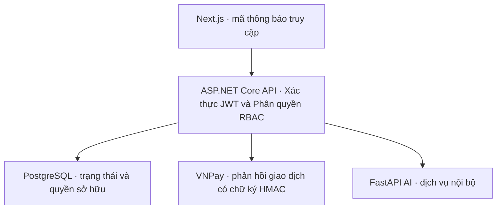

# SportHub — Thiết Kế Bảo Mật

**Phiên bản:** 1.0 · **Ngày rà soát:** 18/11/2026 · **Phạm vi:** bản chụp mã nguồn `sports-center-management-system-develop(3).zip` do chủ dự án cung cấp.

> Đây là tài liệu mô tả thiết kế dựa trên việc kiểm tra tĩnh mã nguồn của bản chụp. Các bản vá Luồng 6 (Flow 6) và cấu hình bốn dự án Gemini được trao đổi sau thời điểm chụp mã nguồn có thể có sự khác biệt. Hệ thống chưa được chạy kiểm thử xâm nhập, kiểm thử tích hợp hay xác minh cấu hình trên môi trường triển khai thực tế. Tên các đường dẫn dưới đây được tính tương đối từ thư mục gốc của kho mã nguồn; tài liệu không ghi nhận khóa bí mật hoặc dữ liệu tài khoản thực.

## 1. Mục tiêu, tài sản và ranh giới tin cậy

Các tài sản cần bảo vệ bao gồm: hồ sơ và thông tin đăng nhập người dùng; lịch lớp học, thông tin đăng ký, điểm danh và giáo án; hóa đơn, ví điểm và lịch sử giao dịch; nội dung hội thoại AI, nhật ký AI (AI logs); các khóa bảo mật JWT, khóa VNPay và khóa Gemini. 

Hệ thống phụ trợ (Backend) ASP.NET Core đóng vai trò là điểm thực thi chính cho việc xác thực, phân quyền và kiểm tra quyền sở hữu. Giao diện người dùng (Frontend) Next.js chỉ đảm nhiệm việc hiển thị và gửi mã thông báo truy cập (bearer token), tuyệt đối không được coi là nơi quyết định quyền hạn. Cơ sở dữ liệu PostgreSQL lưu giữ trạng thái tài khoản và dữ liệu nghiệp vụ. VNPay là cổng thanh toán bên ngoài cung cấp kết quả giao dịch có chữ ký số; FastAPI AI là dịch vụ phụ trợ nội bộ do backend gọi tới.

**Nguyên tắc cốt lõi:** Xác thực danh tính tại tầng API, áp dụng phân quyền theo vai trò ở từng điểm truy cập (endpoint), và tiếp tục kiểm tra quyền sở hữu đối với từng tài nguyên cụ thể ở tầng xử lý nghiệp vụ/truy vấn dữ liệu (service/query). Dữ liệu đầu vào từ người dùng, thông tin xác nhận trong JWT (claims), phản hồi thanh toán và câu trả lời từ AI đều nằm ở các mức độ tin cậy khác nhau.

## 2. Xác thực (Authentication) và Phân quyền (Authorization)

### 2.1 Đăng ký, đăng nhập và khôi phục tài khoản

- Điểm truy cập `POST /api/auth/register/otp` thực hiện gửi mã xác thực một lần (OTP); quy trình đăng ký yêu cầu mã gồm sáu chữ số và khởi tạo tài khoản Thành viên (Member). Mã OTP được xác minh hợp lệ trước khi tạo tài khoản, và chỉ được đánh dấu là đã sử dụng khi lưu tài khoản thành công trong cùng một giao dịch `SaveChanges` (`AuthController.cs:14–35`; `AuthService.cs:105–153`).
- Điểm truy cập `POST /api/auth/login` tìm kiếm tài khoản qua email, đối chiếu mật khẩu đã băm (hashed) và chỉ cấp mã JWT cho các tài khoản đang ở trạng thái hoạt động (`Active`). Trong trường hợp không tìm thấy tài khoản hoặc tài khoản chưa thiết lập mật khẩu, hệ thống sẽ thực hiện một phép băm BCrypt giả lập để cân bằng thời gian phản hồi, nhằm ngăn chặn tấn công dò tìm thông tin qua chênh lệch thời gian (`AuthService.cs:169–210`).
- Tính năng đăng nhập qua Google kiểm tra mã định danh (ID token) bằng thư viện chính thức của Google với đối tượng thụ hưởng (audience) đã cấu hình và email đã được xác minh, sau đó ánh xạ tới tài khoản nội bộ; hệ thống không sử dụng trực tiếp ID token của Google làm mã JWT của SportHub (`GoogleAuthService.cs:22–55`; `GoogleAuthController.cs:16–27`).
- Tính năng quên mật khẩu luôn trả về mã trạng thái `204` mà không tiết lộ email có tồn tại trên hệ thống hay không; việc đặt lại mật khẩu được thực hiện qua mã xác nhận gửi về email. Khi người dùng đổi hoặc đặt lại mật khẩu, hệ thống sẽ cập nhật tem bảo mật (security stamp) để vô hiệu hóa toàn bộ các mã JWT cũ ở các yêu cầu tiếp theo (`AuthController.cs:48–69`; `AccountService.cs:224–237`; `PasswordResetService.cs:112–113`).

### 2.2 Luồng xử lý và xác thực mã JWT

1. Sau khi đăng nhập hoặc đăng ký thành công, backend tạo và ký mã thông báo truy cập (access token) bằng thuật toán HMAC-SHA256. Dữ liệu bên trong (claims) bao gồm mã định danh người dùng (`NameIdentifier`), vai trò (role) và tem bảo mật (`sst`); mã này cũng đính kèm thông tin nhà phát hành (issuer), đối tượng sử dụng (audience) và thời hạn theo giờ quốc tế UTC (`JwtService.cs:10–46`).
2. Frontend lưu trữ mã này trong bộ nhớ cục bộ của trình duyệt (`localStorage`) dưới khóa `sporthub.accessToken`, sau đó tự động đính kèm tiêu đề `Authorization: Bearer ...` vào mọi yêu cầu yêu cầu đăng nhập (`frontend/src/lib/apiClient.ts:14–15,68–75,155–158`).
3. Lớp trung gian (Middleware) xử lý JWT sẽ kiểm tra chữ ký số, thuật toán HS256, nhà phát hành, đối tượng sử dụng và thời hạn hiệu lực với độ lệch đồng hồ (clock skew) cho phép là 1 phút. Khóa bí mật bắt buộc dài tối thiểu 32 ký tự và thời hạn sống của mã có thể cấu hình từ 1 đến 1440 phút, mặc định là 60 phút (`JwtOptions.cs:5–17`; `JwtBearerExtensions.cs:19–75`).
4. Sự kiện `OnTokenValidated` trích xuất mã người dùng từ thông tin đã xác thực, tải trạng thái tài khoản mới nhất từ cơ sở dữ liệu, và từ chối truy cập nếu tài khoản không còn `Active`, tem bảo mật bị thiếu/sai lệch, hoặc vai trò trong mã khác với vai trò hiện tại trong hệ thống. Nếu cơ sở dữ liệu gặp lỗi kết nối, hệ thống sẽ từ chối truy cập thay vì mở quyền mặc định. Các mã JWT phiên bản cũ không chứa trường `sst` cũng bị từ chối (`AccountStatusJwtExtensions.cs:36–94`).
5. Các điểm truy cập yêu cầu đăng nhập nhưng thiếu, sai hoặc hết hạn mã sẽ trả về lỗi `401` (Chưa xác thực); trường hợp đã xác thực nhưng không đủ quyền hạn sẽ trả về lỗi `403` (Cấm truy cập). Chính sách dự phòng (fallback policy) mặc định yêu cầu xác thực đối với mọi điểm truy cập không gắn chính sách riêng; các điểm truy cập công khai bắt buộc phải được gắn nhãn `[AllowAnonymous]` (`JwtBearerExtensions.cs:58–75`; `AuthorizationPolicyExtensions.cs:25–29`).

**Giới hạn về thời điểm vô hiệu hóa:** Việc đối chiếu với cơ sở dữ liệu diễn ra trên từng yêu cầu gửi tới; các yêu cầu đang được xử lý dở dang hoặc các kết nối duy trì dài hạn đã xác thực trước đó sẽ không tự động bị ngắt ngang. Bản chụp mã nguồn hiện tại chưa ghi nhận cơ chế làm mới mã (refresh token) hay quản lý phiên đăng nhập phía máy chủ, do đó tài liệu không mô tả các cơ chế này như đã triển khai.

## 3. Kiểm soát truy cập dựa trên vai trò (RBAC)

Các vai trò được ánh xạ thông qua các chính sách (policy) tại điểm khởi tạo ứng dụng `SportHub.API`; vai trò Quản trị viên hệ thống (`SystemAdministrator`) không mặc nhiên sở hữu toàn bộ các quyền nghiệp vụ (`AuthorizationPolicyExtensions.cs:25–73`). Bảng dưới đây liệt kê các quyền tiêu biểu và không thay thế cho việc kiểm tra chi tiết tại từng điểm truy cập.

| Vai trò / Chính sách | Quyền hạn tiêu biểu trong mã nguồn | Giới hạn cần duy trì |
| --- | --- | --- |
| Thành viên (`Member`) | `Member`, `WalletOwner`, `CourtRental`, `GymCheckIn.ReadSelf` | Chỉ được xem/thao tác trên tài nguyên của chính mình; tuyệt đối không lấy mã thành viên từ nội dung yêu cầu (body) để thay thế danh tính đã xác thực. |
| Huấn luyện viên (`Coach`) | `Coach`, `StaffRead` | Chỉ được truy cập dữ liệu của học viên có mối quan hệ giảng dạy/hướng dẫn hợp lệ; không được xem thông tin học viên tùy ý. |
| Lễ tân (`Receptionist`) | `FrontDesk`, `AttendanceCheckIn`, `GymCheckIn.Create` | Thực hiện các thao tác tại quầy và điểm danh; các thao tác thực hiện thay mặt thành viên phải tuân thủ chặt chẽ luồng kiểm tra của hệ thống. |
| Quản lý trung tâm (`CenterManager`) | `CenterManager`, `CatalogManage`, `RefundApprove`, `PaymentReconciliation`, `FrontDesk` | Chỉ giới hạn trong các quyền được chính sách cấp phép; phạm vi trung tâm và tài nguyên trực thuộc phải tiếp tục được kiểm tra ở tầng nghiệp vụ. |
| Quản trị hệ thống (`SystemAdministrator`) | `SystemAdministrator` | Quản trị cấu hình hệ thống qua các điểm truy cập dành riêng; không tự động kế thừa các chính sách vận hành nghiệp vụ. |

**Kiểm tra bảo mật ở cấp độ bản ghi:** 
- Bộ điều khiển `AiController` lấy mã định danh người thao tác trực tiếp từ JWT; huấn luyện viên muốn tạo gợi ý bài tập cho thành viên khác bắt buộc phải có mối quan hệ hợp lệ (`AiController.cs:75–97`), trong khi thành viên sử dụng đường dẫn `/me` để lấy định danh từ chính JWT của mình (`:100–119`).
- Tính năng AI hỗ trợ lớp học yêu cầu huấn luyện viên phải được phân công phụ trách lớp/buổi học đó, thành viên phải có thông tin ghi danh hợp lệ, và hệ thống thực hiện kiểm tra lại điều kiện này ngay cả sau khi AI đã xử lý xong (`ClassTeachingAiController.cs:24–72`).
- Luồng thanh toán (Checkout) của thành viên từ chối mọi yêu cầu có `TargetMemberId` khác với chính người dùng hiện tại, đồng thời bắt buộc sử dụng khóa chống trùng lặp giao dịch (idempotency key) đối với các thao tác quan trọng (`CheckoutsController.cs:23–54`).
- Các bộ điều khiển hóa đơn (Invoice) và thanh toán đều dựa trên định danh người dùng từ JWT để giới hạn phạm vi truy cập tài nguyên (`InvoicesController.cs:57–58,154–155`; `CheckoutsController.cs:189–213`). 

*Lưu ý:* Các ví dụ trên chưa đủ để khẳng định toàn bộ các điểm truy cập trên hệ thống đã được bảo vệ hoàn toàn khỏi lỗ hổng truy cập trái phép đối tượng trực tiếp (IDOR); đội ngũ phát triển cần rà soát từng hành động cụ thể trước khi phát hành chính thức.

## 4. Bảo mật mật khẩu và mã OTP

Mật khẩu mới được mã hóa bằng thuật toán BCrypt với hệ số chi phí (cost) là 11 kết hợp tính năng tăng cường entropy (`enhancedEntropy`), được lưu trữ kèm tiền tố định dạng `v2$`. Hệ thống vẫn hỗ trợ xác thực các chuỗi băm BCrypt phiên bản cũ và sẽ tự động băm lại theo chuẩn mới sau khi người dùng đăng nhập thành công (`PasswordHasher.cs:5–34`; `AuthService.cs:192–197`).

Chính sách mật khẩu tại tầng nghiệp vụ quy định: độ dài từ 8 đến 64 ký tự Unicode, bao gồm chữ thường, chữ hoa, chữ số, ký tự đặc biệt và không được chứa phần tên tài khoản trước dấu `@` của địa chỉ email (`PasswordPolicy.cs:6–54`). Ngoài ra, các đối tượng truyền dữ liệu (DTO) cũng giới hạn kích thước đầu vào; ví dụ trường mật khẩu giới hạn tối đa 200 ký tự ở bước ánh xạ dữ liệu (model binding) trước khi áp dụng quy tắc 64 ký tự ở tầng nghiệp vụ (`RegisterRequest.cs:9–23`).

Mã OTP bị giới hạn về định dạng, số lần sử dụng và thời gian hiệu lực tùy theo từng luồng nghiệp vụ; mã này không bao giờ được coi là mật khẩu dài hạn. Hệ thống nghiêm cấm việc ghi lại mật khẩu, mã OTP, mã JWT hoặc các chuỗi băm bí mật vào nhật ký hoạt động (logs).

## 5. Kiểm tra dữ liệu đầu vào và An toàn API

- Hệ thống sử dụng `[ApiController]` kết hợp với `DataAnnotations` để kiểm tra tính hợp lệ của dữ liệu đầu vào như `Required` (bắt buộc), `EmailAddress` (định dạng email), `MaxLength` (độ dài tối đa) và biểu thức chính quy cho OTP; các thuộc tính tùy chỉnh như `FullNameAttribute` và `PhoneNumberAttribute` đảm nhận việc kiểm tra định dạng họ tên và số điện thoại (`AuthController.cs:10–12`; `RegisterRequest.cs:7–81`). Tầng nghiệp vụ tiếp tục áp đặt các quy tắc chuyên sâu như chính sách mật khẩu, điều kiện lớp học và trạng thái thanh toán. Việc kiểm tra dữ liệu ở phía frontend chỉ nhằm mục đích nâng cao trải nghiệm người dùng.
- Hệ thống sử dụng các truy vấn LINQ/EF Core cùng các phương thức `FromSqlInterpolated`/`ExecuteSqlInterpolatedAsync` có tham số hóa cho các thao tác xử lý giao dịch quan trọng (`PaymentReconciliationService.cs:110–121,196–202`), giúp phòng chống tấn công chèn mã SQL (SQL Injection). Đội ngũ phát triển cần tiếp tục tuân thủ nguyên tắc không ghép chuỗi SQL trực tiếp từ dữ liệu đầu vào tự do.
- API bảo vệ tài nguyên bằng `[Authorize]`, chính sách vai trò và kiểm tra quyền sở hữu tại máy chủ; các khóa bí mật của Gemini, VNPay và JWT được lưu trữ hoàn toàn trong cấu hình backend, không bao giờ đưa vào các biến môi trường công khai (`NEXT_PUBLIC_*`) hay trả về trong nội dung phản hồi. Kênh truyền tải trên môi trường thực tế (production) bắt buộc sử dụng giao thức HTTPS và quản lý khóa bí mật an toàn.
- Nhật ký AI lưu trữ cả dữ liệu đầu vào lẫn kết quả đầu ra; điểm truy cập `GET /api/ai/logs` cho phép quản lý xem toàn bộ nhật ký, trong khi huấn luyện viên chỉ xem được nhật ký của chính mình và được lọc theo mối quan hệ với học viên (`AiController.cs:175–221`). Cần thiết lập quy định về thời gian lưu trữ, che giấu thông tin nhạy cảm (redaction) và kiểm soát chặt chẽ quyền truy cập nhật ký do dữ liệu có thể chứa thông tin cá nhân và lịch sử tập luyện của người dùng.

## 6. Kiểm soát chia sẻ tài nguyên (CORS), HTTPS và Giới hạn tần suất (Rate limiting)

Cơ chế CORS chỉ chấp nhận các nguồn truy cập (origin) được liệt kê trong cấu hình `Cors:AllowedOrigins`, cho phép mọi tiêu đề/phương thức và bật tính năng gửi thông tin xác thực (`AllowCredentials`). Khi thiếu cấu hình này, mã nguồn hiện đang mặc định sử dụng `http://localhost:3000` ngay cả khi không ở môi trường phát triển (Development). Cần bắt buộc cấu hình danh sách nguồn truy cập hợp lệ trên môi trường production và loại bỏ giá trị mặc định này để đảm bảo nguyên tắc từ chối mặc định khi thiếu cấu hình (fail closed) (`CorsExtensions.cs:15–34`). Lưu ý rằng CORS chỉ là cơ chế kiểm soát của trình duyệt, không thể thay thế cho việc xác thực tại máy chủ.

Luồng xử lý yêu cầu (Pipeline) thực thi tuần tự qua các bước: `UseHttpsRedirection`, định tuyến (routing), CORS, xác thực (authentication), giới hạn tần suất (rate limiter), phân quyền (authorization) và cuối cùng là các bộ điều khiển (controllers) (`Program.cs:593–606`). Việc ép buộc sử dụng HTTPS đầu cuối sẽ phụ thuộc vào cấu hình máy chủ ủy nhiệm (proxy) và chứng chỉ TLS của hạ tầng triển khai.

| Chính sách gắn với điểm truy cập | Giới hạn tần suất | Phân vùng áp dụng |
| --- | ---: | --- |
| `auth-login` | 10 yêu cầu/phút | Địa chỉ IP |
| `auth-register` | 5 yêu cầu/phút | Địa chỉ IP |
| `auth-register-otp`, `auth-password-reset` | 3 yêu cầu/phút mỗi chính sách | Địa chỉ IP |
| `point-confirmation` | 3 yêu cầu/phút | Địa chỉ IP + mã băm tiêu đề Authorization |
| `checkout-write`, `prompt-test` | 20 yêu cầu/phút mỗi chính sách | Định danh người dùng hoặc dự phòng theo IP |
| `avatar-write` | 10 yêu cầu/phút | Mã người dùng hoặc địa chỉ IP |
| `vnp-ipn` | 120 yêu cầu/phút | Địa chỉ IP |

*Nguồn tham chiếu:* `Program.cs:124–216`; `LoginRateLimitPolicy.cs:20–80`. 

Khi vượt quá hạn mức cho phép, hệ thống trả về mã lỗi `429` (Quá nhiều yêu cầu); riêng điểm truy cập đăng nhập sẽ trả về định dạng JSON riêng kèm tiêu đề `Retry-After` nếu bộ giới hạn cung cấp thông tin thời gian chờ. Cần lưu ý rằng bộ giới hạn hiện tại lưu trữ **trong bộ nhớ của từng tiến trình (in-memory per instance)**, không đồng bộ dữ liệu khi chạy nhiều máy chủ (đa replica), và việc sử dụng proxy hoặc mạng NAT có thể làm sai lệch địa chỉ IP dẫn đến tính toán sai hạn mức. Chức năng đăng nhập hiện chưa có cơ chế khóa tạm thời theo từng tài khoản, do đó chưa thể thay thế hoàn toàn các giải pháp chống tấn công dò mật khẩu phân tán ở tầng biên mạng (edge/gateway). Các chính sách này chỉ có hiệu lực trên những điểm truy cập có gắn thuộc tính `[EnableRateLimiting]`, không áp dụng tự động cho toàn bộ API. Khi triển khai sau reverse proxy, hệ thống phải cấu hình danh sách proxy tin cậy (`trusted forwarded headers/known proxies`) và tuyệt đối không tin tưởng tiêu đề `X-Forwarded-For` do phía khách hàng tự gửi lên (`LoginRateLimitPolicy.cs:58–63`).

## 7. Bảo mật thanh toán

1. Backend khởi tạo đường dẫn thanh toán VNPay với số tiền VNĐ là số nguyên dương, quy đổi đơn vị tiền tệ theo đúng chuẩn giao thức và ký xác thực bằng thuật toán HMAC-SHA512. Trên môi trường production, ứng dụng sẽ từ chối khởi động nếu thiếu mã đối tác (merchant code), khóa bí mật (hash secret) hoặc nếu các đường dẫn thanh toán, phản hồi và truy vấn không sử dụng giao thức HTTPS (`VnPayGateway.cs:18–35`; `Program.cs:371–386`).
2. Điểm truy cập `return` công khai chỉ dùng để hiển thị trạng thái chờ xử lý IPN; hệ thống **tuyệt đối không lấy việc chuyển hướng trình duyệt làm bằng chứng giao dịch đã thanh toán thành công**. Điểm truy cập IPN công khai tiếp nhận tham số truy vấn, kiểm tra chữ ký HMAC bằng phương pháp so sánh thời gian hằng số (constant-time comparison), đồng thời đối chiếu mã đối tác, số tiền và các trường thông tin giao dịch trước khi xử lý (`PaymentsController.cs:32–65`; `VnPaySigner.cs:10–28`; `VnPayGateway.cs:38–58`).
3. Phản hồi giao dịch được đối chiếu mã tham chiếu và số tiền với phiên thanh toán tương ứng, kiểm tra tính hợp lệ về thời gian và ghi nhận sự kiện đã xác minh trước khi cấp quyền lợi cho người dùng. Việc áp dụng ràng buộc duy nhất cho mã giao dịch từ nhà cung cấp kết hợp lệnh `ON CONFLICT DO NOTHING` và khóa bản ghi trong giao dịch giúp ngăn chặn lỗi xử lý trùng lặp hoặc tranh chấp đồng thời (race condition) khi nhận nhiều phản hồi cùng lúc (`PaymentReconciliationService.cs:96–146,188–247`). Các giao dịch lỗi hoặc phản hồi đến muộn được đưa vào luồng đối soát (reconciliation) hoặc đánh dấu chưa kích hoạt thay vì tự động cộng điểm/gói dịch vụ một cách thiếu kiểm chứng.
4. Tính năng truy vấn kết quả giao dịch chủ động (QueryDR) xác minh đầy đủ chữ ký phản hồi, mã đối tác, mã tham chiếu, loại lệnh và số tiền; nếu hệ thống đối tác gặp lỗi hoặc quá thời gian chờ, giao dịch sẽ không được coi là đã thanh toán (`VnPayGateway.cs:99–160,163–209`). Quy trình thanh toán của người dùng yêu cầu phải có mã JWT hợp lệ và quyền sở hữu đối với hóa đơn; một số lệnh khởi tạo hoặc thử lại giao dịch bắt buộc sử dụng khóa chống trùng lặp `Idempotency-Key` (`CheckoutsController.cs:23–54,189–232`).

**Khuyến nghị vận hành:** Lưu trữ `HashSecret` và khóa bí mật JWT tách biệt hoàn toàn khỏi kho mã nguồn, phân quyền truy cập khóa bí mật theo từng môi trường và thực hiện xoay vòng khóa định kỳ theo quy trình. Giám sát chặt chẽ các phản hồi giao dịch lỗi, hàng đợi đối soát và giới hạn nghiêm ngặt quyền hạn của nhân viên được phép phê duyệt hoàn tiền. Không ghi lại toàn bộ đường dẫn chứa chữ ký số, thông tin thanh toán nhạy cảm hay thông tin xác thực vào nhật ký hệ thống. Các khuyến nghị vận hành này cần được kiểm chứng thực tế trên môi trường triển khai.

## 8. Rủi ro tồn đọng và kế hoạch khắc phục

| Mức độ ưu tiên | Vấn đề phát hiện từ bản chụp mã nguồn | Hướng xử lý và xác minh |
| --- | --- | --- |
| Cao | Dịch vụ FastAPI `ai-service/app/main.py` mở các đường dẫn `/member/chat`, `/coach/chat`, `/coach/plan` nhưng các bộ định tuyến (router) này không có lớp kiểm tra xác thực; nếu dịch vụ bị lộ ra mạng công cộng, kẻ tấn công có thể gọi trực tiếp mà bỏ qua hoàn toàn lớp bảo vệ JWT/RBAC của .NET. | Chỉ cấu hình dịch vụ lắng nghe trên mạng nội bộ, thiết lập tường lửa chặn truy cập từ bên ngoài; bổ sung cơ chế xác thực giao tiếp giữa các dịch vụ (service-to-service) và kiểm thử khả năng truy cập trực tiếp trước khi vận hành. |
| Cao | Việc lưu trữ mã JWT trong `localStorage` khiến mã này có nguy cơ bị đánh cắp nếu ứng dụng tồn tại lỗ hổng chèn mã độc XSS (`frontend/src/lib/apiClient.ts:14–15,68–75`). | Rà soát toàn diện lỗ hổng XSS, thiết lập chính sách bảo mật nội dung (CSP), kiểm tra các thư viện phụ thuộc và mọi luồng hiển thị nội dung HTML/phản hồi từ AI; cân nhắc chuyển sang sử dụng cookie phiên với cờ `HttpOnly` và `SameSite` nếu có điều kiện nâng cấp kiến trúc. |
| Trung bình | Cấu hình CORS tự động quay về giá trị mặc định `localhost` khi thiếu thiết lập trên mọi môi trường (`CorsExtensions.cs:23–33`). | Bắt buộc khai báo danh sách nguồn truy cập hợp lệ trên môi trường production và thiết lập cơ chế từ chối khi thiếu cấu hình (fail closed); kiểm thử các yêu cầu preflight từ tên miền lạ. |
| Trung bình | Bộ giới hạn tần suất hoạt động trên bộ nhớ cục bộ theo IP, thiếu giới hạn tổng thể và không chia sẻ trạng thái giữa nhiều máy chủ (`Program.cs:124–216`; `LoginRateLimitPolicy.cs:15–18`). | Bổ sung bộ giới hạn phân tán hoặc tại tầng biên mạng, áp dụng cơ chế chống dò mật khẩu theo từng tài khoản và cấu hình danh sách proxy tin cậy. |
| Trung bình | Nhật ký AI chứa toàn bộ nội dung đầu vào/đầu ra và tài khoản quản lý có thể đọc tập dữ liệu nhật ký rất rộng (`AiController.cs:175–221`). | Phân loại dữ liệu nhạy cảm, quy định thời hạn lưu trữ, áp dụng cơ chế che giấu thông tin cá nhân (redaction) và rà soát lại quyền đọc nhật ký; kiểm tra tính chính xác của việc phân tách dữ liệu theo từng trung tâm. |
| Cần kiểm thử | Chưa có kết quả kiểm thử thực tế hay kiểm thử xâm nhập đối với bản chụp mã nguồn này. | Thực hiện kiểm thử với mã JWT giả mạo/sai vai trò/thay đổi tem bảo mật, kiểm thử lỗ hổng IDOR giữa thành viên và huấn luyện viên, giả lập phản hồi VNPay sai lệch/trùng lặp/đến muộn, kiểm tra CORS và giới hạn tần suất qua proxy, cũng như thử gọi trực tiếp dịch vụ AI. |

## 9. Ma trận kiểm thử bảo mật đề xuất

| Kịch bản kiểm thử | Kết quả kỳ vọng |
| --- | --- |
| Thiếu mã JWT, mã hết hạn hoặc sai thông tin nhà phát hành/đối tượng/thuật toán | Trả về mã lỗi `401`; các hành động được bảo vệ không được phép thực thi. |
| Tài khoản bị khóa, vừa đặt lại mật khẩu, thay đổi vai trò hoặc cập nhật tem bảo mật | Mã JWT cũ bị từ chối ngay lập tức ở yêu cầu tiếp theo. |
| Thành viên gửi `TargetMemberId` của người khác; huấn luyện viên truy cập dữ liệu học viên không thuộc quyền quản lý | Trả về mã lỗi `403` hoặc thông báo lỗi nghiệp vụ tương ứng; tuyệt đối không làm rò rỉ dữ liệu. |
| Thành viên hoặc huấn luyện viên gọi vào các điểm truy cập dành cho quản lý hoặc đối soát thanh toán | Trả về mã lỗi `403`. |
| Gửi yêu cầu lấy mã OTP hoặc đăng nhập vượt quá ngưỡng cho phép | Trả về mã lỗi `429` theo đúng chính sách và phân vùng tương ứng. |
| Phản hồi IPN từ VNPay bị sai chữ ký, sai số tiền hoặc trùng lặp mã giao dịch | Không thực hiện cộng quyền lợi hai lần; trả về mã lỗi chuẩn của VNPay và ghi nhận sự kiện để phục vụ đối soát. |
| Gọi trực tiếp vào dịch vụ FastAPI từ mạng Internet bên ngoài | Không thể thiết lập kết nối hoặc bị chặn đứng bởi lớp xác thực nội bộ giữa các dịch vụ. |

## 10. Danh mục mã nguồn đã rà soát

- `backend/SportHub.API/Program.cs`, `Extensions/{AuthorizationPolicyExtensions,AccountStatusJwtExtensions,CorsExtensions}.cs`, `RateLimiting/LoginRateLimitPolicy.cs`.
- `backend/SportHub.BuildingBlocks/Infrastructure/Authentication/{JwtOptions,JwtService,JwtBearerExtensions}.cs`.
- `backend/SportHub.Identity/{Api,Application/Services,Application/Commands,Infrastructure/Security}`.
- `backend/SportHub.Payment/{Api,Application/Services/PaymentReconciliationService.cs,VnPay}`.
- `backend/SportHub.AI/Api/{AiController,ClassTeachingAiController}.cs`; `ai-service/app/{main.py,api/member.py,api/coach.py}`; `frontend/src/lib/apiClient.ts`.

**Phương pháp rà soát:** Đọc phân tích mã nguồn tĩnh và đối chiếu luồng xử lý giữa các phân hệ; hiện chưa có xác nhận rằng cấu hình trên môi trường thực tế, các bản cập nhật cơ sở dữ liệu (migration) và quy trình triển khai hiện hành hoàn toàn trùng khớp với bản chụp mã nguồn này.