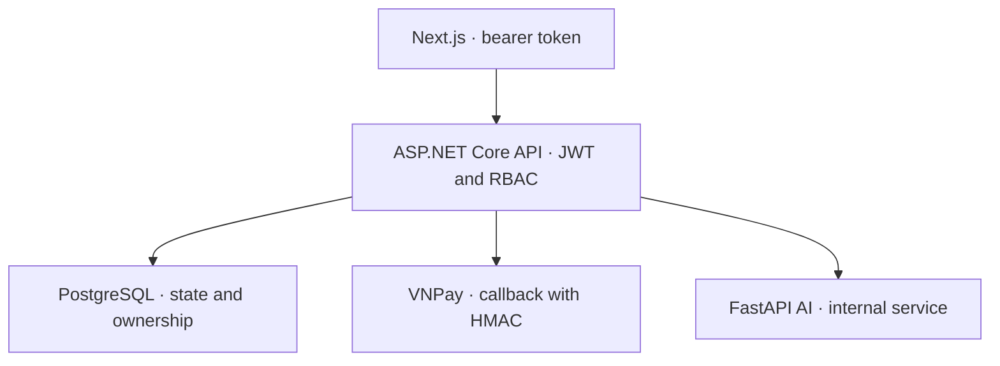

# SportHub — Security Design

**Version:** 1.0 · **Review date:** 18/11/2026 · **Scope:** source snapshot `sports-center-management-system-develop(3).zip` provided by the project owner.

> This design description is based on a static review of the source code in the snapshot. Flow 6 patches and the four-Gemini-project configuration discussed after the snapshot may differ. No penetration testing, integration testing, or deployment-environment configuration verification has been performed. Paths below are relative to the repository root; no secret keys or real account data are included.

## 1. Objectives, assets, and trust boundaries

Assets to protect include user profiles and login information; class schedules, enrollments, attendance, and lesson plans; invoices, point wallets, and transactions; AI conversation content and AI logs; JWT keys, VNPay keys, and Gemini keys. The ASP.NET Core backend is the enforcement point for authentication, authorization, and ownership checks. The Next.js frontend only presents the UI and sends bearer tokens; it must not be treated as the authority for access decisions. PostgreSQL stores account state and business data. VNPay is an external party that provides signed transaction results; the FastAPI AI service is an auxiliary service called by the backend.

**Principle:** authenticate identity at the API, enforce role-based permissions at endpoints, and continue checking resource-level authorization in the service/query layer. User input, JWT claims, payment callbacks, and AI responses exist at different trust levels.

## 2. Authentication and Authorization

### 2.1 Registration, login, and recovery

- `POST /api/auth/register/otp` sends an OTP; registration requires a six-digit code and creates a Member account. The OTP is verified before account creation and is marked as used only when the account is persisted in the same `SaveChanges` call (`AuthController.cs:14–35`; `AuthService.cs:105–153`).
- `POST /api/auth/login` looks up the account by email, verifies the hashed password, and only issues a JWT for an `Active` account. The branch for a missing account or missing password performs a dummy BCrypt operation once to reduce timing differences (`AuthService.cs:169–210`).
- Google login validates the ID token using the Google library with the configured audience and verified email, then maps it to an internal account; the Google ID token is not used directly as SportHub's JWT (`GoogleAuthService.cs:22–55`; `GoogleAuthController.cs:16–27`).
- Forgot-password returns `204` without confirming whether the email exists; reset is performed through an email token. Changing or resetting the password changes the security stamp so old JWTs are invalidated on the next request (`AuthController.cs:48–69`; `AccountService.cs:224–237`; `PasswordResetService.cs:112–113`).

### 2.2 JWT flow and token validation

1. After successful login/registration, the backend signs an HMAC-SHA256 access token. Claims include the user ID (`NameIdentifier`), role, and security stamp (`sst`); the token has an issuer, audience, and UTC expiration (`JwtService.cs:10–46`).
2. The frontend stores the token in `localStorage` under `sporthub.accessToken`, then adds `Authorization: Bearer ...` to authenticated requests (`frontend/src/lib/apiClient.ts:14–15,68–75,155–158`).
3. JWT middleware validates the signature, HS256 algorithm, issuer, audience, and lifetime; clock skew is 1 minute. The secret must be at least 32 characters, and the configured lifetime must be between 1–1440 minutes, defaulting to 60 minutes (`JwtOptions.cs:5–17`; `JwtBearerExtensions.cs:19–75`).
4. `OnTokenValidated` reads the user ID from the authenticated principal, loads account state from the DB, and rejects accounts that are not `Active`, have a missing/mismatched stamp, or whose current role differs from the role in the token. DB errors do not fail open. Legacy tokens missing `sst` are also rejected (`AccountStatusJwtExtensions.cs:36–94`).
5. Authenticated endpoints with missing/invalid/expired tokens return `401`; authenticated users lacking permission receive `403`. The fallback policy requires authentication for endpoints without a dedicated policy; public endpoints must be marked `[AllowAnonymous]` (`JwtBearerExtensions.cs:58–75`; `AuthorizationPolicyExtensions.cs:25–29`).

**Revocation timing limitation:** the DB check occurs on each authenticated request; an in-flight request and a long-lived connection that has already been authenticated are not automatically terminated. The snapshot does not show refresh tokens or server-side sessions; such mechanisms must not be described as implemented.

## 3. Role-based access control (RBAC)

Roles are mapped to policies at the `SportHub.API` composition root; `SystemAdministrator` does not implicitly inherit all business permissions (`AuthorizationPolicyExtensions.cs:25–73`). The table shows representative permissions and does not replace per-endpoint checks.

| Role / policy | Representative permissions in code | Required restriction |
| --- | --- | --- |
| Member | `Member`, `WalletOwner`, `CourtRental`, `GymCheckIn.ReadSelf` | View/manage only their own resources; do not accept a member ID from the request body as a substitute for authenticated identity. |
| Coach | `Coach`, `StaffRead` | Access students only when a valid coaching relationship exists; no arbitrary member access. |
| Receptionist | `FrontDesk`, `AttendanceCheckIn`, `GymCheckIn.Create` | Front-desk operations and attendance; acting on behalf of members only through validated flows. |
| CenterManager | `CenterManager`, `CatalogManage`, `RefundApprove`, `PaymentReconciliation`, `FrontDesk` | Only permissions explicitly granted by policy; center/resource scope must still be enforced in services. |
| SystemAdministrator | `SystemAdministrator` | System-administration access on dedicated endpoints; does not automatically inherit operational policies. |

**Record-level checks:** `AiController` derives the actor ID from the JWT; a coach creating a workout suggestion for another member must have a valid relationship (`AiController.cs:75–97`); a member using `/me` gets the ID from the JWT (`:100–119`). Class AI requires the coach to be assigned to the class/session and the member to have a valid enrollment, then rechecks authorization after the AI call (`ClassTeachingAiController.cs:24–72`). Member checkout rejects a `TargetMemberId` different from the authenticated member and requires an idempotency key for the applicable operations (`CheckoutsController.cs:23–54`). Invoice and checkout operations use actor IDs to restrict resource access (`InvoicesController.cs:57–58,154–155`; `CheckoutsController.cs:189–213`). These examples do not prove that every endpoint is free from IDOR; each action still requires audit before release.

## 4. Passwords and OTP

New passwords are stored using BCrypt cost 11 with `enhancedEntropy` and a `v2$` format prefix; older plain BCrypt hashes can still be verified and are rehashed after a successful login (`PasswordHasher.cs:5–34`; `AuthService.cs:192–197`). The service policy requires 8–64 Unicode characters with lowercase, uppercase, digit, and special character, and disallows inclusion of the email local-part (`PasswordPolicy.cs:6–54`). DTOs also constrain request size; for example, password is limited to 200 characters during model binding, followed by the 64-character service policy (`RegisterRequest.cs:9–23`). OTPs are constrained by format, one-time use, and flow-specific expiration. They must not be treated as long-term passwords. Passwords, OTPs, JWTs, or secret hashes must not be written to logs.

## 5. Input validation and API safety

- `[ApiController]` together with DataAnnotations validates request models using rules such as `Required`, `EmailAddress`, `MaxLength`, and OTP regex; `FullNameAttribute` and `PhoneNumberAttribute` validate their respective formats (`AuthController.cs:10–12`; `RegisterRequest.cs:7–81`). Services continue to enforce business rules such as password, class, and payment-state logic. Frontend validation is for user experience only.
- LINQ/EF Core queries and `FromSqlInterpolated`/`ExecuteSqlInterpolatedAsync` with parameters are used for the reviewed transaction operations (`PaymentReconciliationService.cs:110–121,196–202`). Continue to avoid concatenating raw input into SQL.
- The API uses `[Authorize]`, role policies, and server-side ownership checks; Gemini/VNPay/JWT API keys belong in backend configuration, not `NEXT_PUBLIC_*` variables or responses. Production traffic requires HTTPS and proper secret management in the deployment environment.
- AI logs contain input/output payloads; `GET /api/ai/logs` allows managers to view the full set, while coaches can only view logs belonging to themselves and are further filtered by member relationship (`AiController.cs:175–221`). Retention, redaction, and log-access rules must be defined because payloads may contain training or personal data.

## 6. CORS, HTTPS, and rate limiting

CORS only accepts origins from `Cors:AllowedOrigins`, allows all headers/methods, and enables `AllowCredentials`. When configuration is missing, the code falls back to `http://localhost:3000` even outside Development; production must require explicit allowed origins and remove the fallback so it fails closed (`CorsExtensions.cs:15–34`). CORS is a browser control and does not replace authentication. The pipeline executes `UseHttpsRedirection`, routing, CORS, authentication, rate limiting, authorization, and controllers in that order (`Program.cs:593–606`). End-to-end HTTPS enforcement still depends on the deployment proxy/TLS setup.

| Endpoint policy | Limit | Partition |
| --- | ---: | --- |
| `auth-login` | 10/minute | IP |
| `auth-register` | 5/minute | IP |
| `auth-register-otp`, `auth-password-reset` | 3/minute per policy | IP |
| `point-confirmation` | 3/minute | IP + hash of Authorization header |
| `checkout-write`, `prompt-test` | 20/minute per policy | User/identity or IP fallback |
| `avatar-write` | 10/minute | User ID or IP |
| `vnp-ipn` | 120/minute | IP |

Source: `Program.cs:124–216`; `LoginRateLimitPolicy.cs:20–80`. When the quota is exceeded, the API returns `429`; login has a dedicated JSON response and `Retry-After` when provided by the lease. The limiter is **in-memory per instance** and is not shared across replicas; proxies/NAT may distort IP identity and quotas. Login currently lacks account-based partitioning, so this does not replace distributed brute-force protection at the edge/gateway. Policies only apply to endpoints annotated with `[EnableRateLimiting]`; they are not global API limits. Behind a reverse proxy, trusted forwarded headers/known proxies must be configured, and client-supplied `X-Forwarded-For` must never be trusted directly (`LoginRateLimitPolicy.cs:58–63`).

## 7. Payment security

1. The backend creates VNPay payment URLs with a positive integer VND amount, converts units according to the protocol, and signs requests with HMAC-SHA512. Production startup is rejected if the merchant code/hash secret or payment, return, and query URLs are missing or not HTTPS (`VnPayGateway.cs:18–35`; `Program.cs:371–386`).
2. The public `return` endpoint only reports that IPN is pending; **the browser redirect is not treated as proof of payment**. The public IPN endpoint receives query parameters and verifies HMAC using constant-time comparison, merchant code, amount, and transaction fields before processing (`PaymentsController.cs:32–65`; `VnPaySigner.cs:10–28`; `VnPayGateway.cs:38–58`).
3. The callback is matched by reference and amount against the payment attempt, validates timing, records a verified event before fulfillment, and uses a unique provider transaction plus `ON CONFLICT DO NOTHING` and row locking inside a transaction to handle duplicate/racing callbacks (`PaymentReconciliationService.cs:96–146,188–247`). Errors or late callbacks are routed to reconciliation/unactivated flows instead of granting entitlements without verification.
4. QueryDR proactively verifies the response signature, merchant, reference, command, and amount; upstream errors/timeouts are not treated as successful payment (`VnPayGateway.cs:99–160,163–209`). Member checkout requires JWT authentication and invoice ownership; some create/retry commands require `Idempotency-Key` (`CheckoutsController.cs:23–54,189–232`).

**Operations:** keep `HashSecret` and JWT secrets outside the repository, scope secrets by environment, and rotate keys through an established process; monitor failed callbacks and the reconciliation queue, and restrict refund-approval privileges. Do not log full signed URLs, payment information, or credentials. These operational recommendations must be validated in the real deployment environment.

## 8. Remaining risks and required actions

| Priority | Finding from snapshot | Remediation / verification |
| --- | --- | --- |
| High | FastAPI `ai-service/app/main.py` mounts `/member/chat`, `/coach/chat`, `/coach/plan` while those routers have no authentication dependency; if the service is public, it can be called directly and bypass .NET JWT/RBAC. | Bind to an internal network only, firewall ingress, add service-to-service authentication, and test direct access before exposing it externally. |
| High | JWT is stored in `localStorage` and can be stolen through XSS (`frontend/src/lib/apiClient.ts:14–15,68–75`). | Audit XSS, CSP, dependencies, and every path that renders AI/HTML content; consider an HttpOnly/SameSite session-cookie design if the architecture changes. |
| Medium | CORS falls back to localhost whenever configuration is missing, including non-Development environments (`CorsExtensions.cs:23–33`). | Require explicit production origins and fail closed; test preflight requests from unknown origins. |
| Medium | Rate limiting is memory/IP based, lacks global enforcement, and is not shared across instances (`Program.cs:124–216`; `LoginRateLimitPolicy.cs:15–18`). | Add edge/distributed rate limiting, account-based brute-force protection, and trusted-proxy configuration. |
| Medium | AI logs contain input/response payloads and managers can read a broad log set (`AiController.cs:175–221`). | Classify sensitive data, define retention and redaction, audit read access, and verify center-level partitioning. |
| Requires testing | No runtime/penetration-test results exist for the snapshot. | Test forged JWTs/wrong roles/stamp changes, cross-member/coach IDOR, forged/duplicate/late VNPay callbacks, CORS and rate limiting behind a proxy, and direct calls to the AI service. |

## 9. Proposed verification matrix

| Scenario | Expected result |
| --- | --- |
| Missing JWT, expired JWT, wrong issuer/audience/algorithm | `401`; protected action does not execute. |
| Locked account, password reset, role change, or stamp change | Old JWT is rejected on the next request. |
| Member sends another user's `TargetMemberId`; coach accesses a student outside an authorized relationship | `403` / corresponding business error; no data exposure. |
| Member/Coach calls management or reconciliation endpoints | `403`. |
| OTP/login exceeds the configured threshold | `429` according to the applicable policy and partition. |
| IPN with invalid signature/wrong amount/duplicate transaction | No double fulfillment; appropriate VNPay error code; event remains reconcilable. |
| FastAPI called directly from the Internet | Connection is unavailable or blocked by inter-service authentication after mitigations are deployed. |

## 10. Reviewed source files

- `backend/SportHub.API/Program.cs`, `Extensions/{AuthorizationPolicyExtensions,AccountStatusJwtExtensions,CorsExtensions}.cs`, `RateLimiting/LoginRateLimitPolicy.cs`.
- `backend/SportHub.BuildingBlocks/Infrastructure/Authentication/{JwtOptions,JwtService,JwtBearerExtensions}.cs`.
- `backend/SportHub.Identity/{Api,Application/Services,Application/Commands,Infrastructure/Security}`.
- `backend/SportHub.Payment/{Api,Application/Services/PaymentReconciliationService.cs,VnPay}`.
- `backend/SportHub.AI/Api/{AiController,ClassTeachingAiController}.cs`; `ai-service/app/{main.py,api/member.py,api/coach.py}`; `frontend/src/lib/apiClient.ts`.

**Verification method:** static source-code review and cross-module flow inspection; there is no confirmation that the current production configuration, migrations, and deployment match this snapshot.
